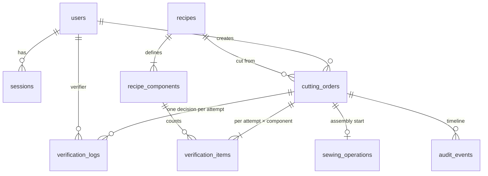

# ApparelFlow ERP — Cutting Operations & Gatekeeper Verification

A full-stack garment-manufacturing ERP module built for the Webtezza (Pvt) Ltd engineering challenge.
Cutting Supervisors record cut batches, Cutting Verifiers physically count every component, and **only
fully counted, shortage-free batches approved by an authenticated verifier ever reach the Sewing Queue.**

> **Live URL:** _not yet deployed — see [Deployment](#deployment)._
> **Sign-in accounts:** see [User accounts](#user-accounts).

---

## Contents

- [Core invariant](#core-invariant)
- [Technology stack](#technology-stack)
- [Project structure](#project-structure)
- [Database schema](#database-schema)
- [Business rules](#business-rules)
- [Security controls](#security-controls)
- [Getting started](#getting-started)
- [Environment variables](#environment-variables)
- [Commands](#commands)
- [Testing](#testing)
- [Deployment](#deployment)
- [User accounts](#user-accounts)
- [API reference](#api-reference)
- [Known limitations](#known-limitations)

---

## Core invariant

**A cutting batch can enter the Sewing Queue only after an authenticated Cutting Verifier has explicitly
approved it and every required component has been counted without any shortage.**

It is enforced in four independent layers — removing any one of them still leaves the invariant protected:

| Layer | Mechanism |
|---|---|
| UI | Approve button disabled while any count is missing, invalid or RED (convenience only). |
| API | `POST /api/verification/:id/approve` requires the `cutting_verifier` role (403 otherwise) and returns 422 for missing counts, shortages or a non-pending order. |
| Use case | One transaction with `SELECT … FOR UPDATE` on the order: re-checks state, component coverage, completeness and shortages, then writes an immutable log and the `VERIFIED` transition atomically. |
| Database | A PostgreSQL trigger rejects any transition to `VERIFIED` unless an `APPROVED` log exists for the attempt **and** every item is counted with no shortage; `UNIQUE(order_id, attempt_no)` on decisions; sewing operations can only reference `VERIFIED` orders. |

This was mutation-tested: deleting the application's shortage check still yields **422** (the trigger
blocks it), and deleting the row lock makes the concurrency tests fail.

## Technology stack

| Concern | Choice |
|---|---|
| Framework | Next.js 16 (App Router, Cache Components / Partial Prerendering), React 19, strict TypeScript |
| UI | Tailwind CSS v4, lucide icons, native `<dialog>` modals, own accessible component kit |
| API | Next.js Route Handlers bound to a backend route table → controllers → services; Server Actions for sign-in/sign-out |
| Database | PostgreSQL (production: any managed provider, e.g. Neon) |
| ORM / migrations | Drizzle ORM + drizzle-kit SQL migrations (+ hand-written trigger migration) |
| Validation | Zod v4 (shared by client forms and server) |
| Auth | Server-side sessions in PostgreSQL, opaque token in an `HttpOnly` cookie, Argon2id (`@node-rs/argon2`) |
| Tests | Vitest (unit + HTTP-level integration on real PostgreSQL), Playwright + axe-core (E2E, a11y) |
| Local DB | `embedded-postgres` — real PostgreSQL binaries via npm, no Docker required |
| CI | GitHub Actions with a PostgreSQL service |

## Project structure

The repository is split into a **frontend** (the Next.js app: pages and UI), a **backend** (routes,
controllers, middleware, services, database, tests) and a small **shared** folder for code both sides
use (business rules, validation schemas, permissions). It is still one Next.js application and one
deployment; `frontend/` is the Next.js project directory and compiles `../backend` and `../shared`.

```
apparelflow-erp/
├── frontend/                       # Next.js project (App Router)
│   ├── app/                        # pages / screens (Next.js "app" router — this is the pages folder)
│   │   ├── (app)/                  #   signed-in area: orders, verification, sewing, recipes, audit
│   │   ├── login/                  #   sign-in page
│   │   └── api/**/route.ts         #   one-line bindings: export const { GET, POST } = apiRoutes[path]
│   ├── components/                 # ui/ layout/ status/ + screen components per area
│   │   └── auth/ orders/ recipes/ verification/ sewing/ audit/
│   ├── lib/                        # browser API client (fetch wrapper)
│   ├── proxy.ts                    # optimistic redirect to /login (not a security boundary)
│   ├── next.config.ts
│   └── package.json                # workspace manifest (deps are installed at the root)
├── backend/
│   ├── routes/                     # API route table: path + method → controller (single source of truth)
│   ├── controllers/                # HTTP layer: parse/validate request → call service → JSON response;
│   │                               #   auth.actions.ts = sign-in/sign-out Server Actions
│   ├── middleware/                 # api-handler (errors, CSRF, logging), auth guards (session + RBAC)
│   ├── services/                   # business logic & queries: auth, recipes, orders, verification, sewing, audit
│   ├── db/                         # schema, client, migrate, seed, migrations/ (SQL), scripts/ (dev-db, migrate, seed)
│   ├── config/                     # validated environment variables
│   ├── utils/                      # structured logger
│   └── tests/                      # unit/, integration/ (real PostgreSQL), helpers/
├── shared/                         # used by frontend AND backend (no server-only code)
│   ├── domain/                     # multiplier, traffic light, wastage
│   ├── validation/                 # Zod schemas (forms + API)
│   ├── permissions.ts types.ts errors.ts format.ts
├── e2e/                            # Playwright end-to-end tests
├── AI_OPTIMIZATION_REPORT.md
├── README.md
└── package.json                    # scripts + all dependencies (npm workspace root)
```

Request flow for an API call: `frontend/app/api/.../route.ts` → `backend/routes` → `backend/controllers/*`
(wrapped by `backend/middleware/api-handler`, guarded by `backend/middleware/auth`) → `backend/services/*` →
`backend/db`. Pages are Server Components that call the same services directly after the same auth guard.

> There is deliberately no `frontend/pages/` folder: in Next.js a `pages/` directory switches on the legacy
> Pages Router. Screens live in `frontend/app/` (the App Router's pages folder).

## Database schema



| Table | Key columns & constraints |
|---|---|
| `users` | `email` unique + lowercase check, `password_hash` (Argon2id), `role` enum |
| `sessions` | `id` = SHA-256 of the cookie token, `expires_at`; cascade on user delete |
| `recipes` | `recipe_code` unique, `std_fabric_yards numeric(6,2) > 0`, `wastage_cap numeric(5,2)` 0–100 |
| `recipe_components` | `(recipe_id, component_name)` unique, `pieces_per_garment > 0`, `image_url` nullable |
| `cutting_orders` | `order_no` unique (sequence `CO-YYYY-NNNNNN`), `target_qty` 1–100 000, `actual_fabric_yds numeric(10,2) ≥ 0`, `status` enum, `current_attempt ≥ 1`, `UNIQUE(created_by, idempotency_key)` |
| `verification_items` | `UNIQUE(order_id, attempt_no, component_id)`, `expected_qty > 0`, `actual_qty` nullable `≥ 0`, `status` nullable; checks: status present **iff** counted, and status must match the numbers (GREEN/YELLOW/RED) |
| `verification_logs` | `UNIQUE(order_id, attempt_no)`, `decision` enum, rejection note required (≥ 5 chars) for REJECTED and null for APPROVED, fabric + wastage snapshot, `component_variances jsonb` snapshot, server `timestamp`; **append-only (trigger)** |
| `sewing_operations` | `UNIQUE(order_id)`, `started_by`, `started_at`; insert only for VERIFIED orders (trigger), no delete |
| `audit_events` | `event_type` enum, actor, order, `payload jsonb`, `seq` identity for deterministic ordering; **append-only (trigger)** |

All timestamps are `timestamptz` (UTC) and are displayed in `Asia/Colombo` by default
(`NEXT_PUBLIC_DISPLAY_TIMEZONE`).

### Order status state machine (enforced by trigger `cutting_orders_status_guard`)

```
INSERT ─► PENDING_VERIFICATION ──approve──► VERIFIED   (terminal for cutting)
                 │   ▲
          reject │   │ re-cut (attempt + 1, new uncounted items)
                 ▼   │
               REJECTED
```

Sewing state is stored separately in `sewing_operations`, so starting assembly never overwrites the fact
that the batch was verified.

## Business rules

- **Component multiplier:** `expected = target quantity × pieces per garment`, computed on the server from
  the database recipe at order creation (and again for each re-cut). Client-supplied expected counts are
  ignored. 50 Casual Blouses → 50 / 50 / 100 / 50 / 100; 50 Crop Tops → 50 / 50 / 50 / 50 / 100.
- **Traffic light:** GREEN `actual = expected`, YELLOW `actual > expected`, RED `actual < expected`.
  An uncounted component is *incomplete* — never zero and never verified. YELLOW surplus does not block
  approval; any RED or uncounted component does.
- **Fabric wastage:** `expected fabric = target × std yards`; `wastage % = (actual − expected) / expected × 100`,
  computed in integer hundredths with a single division and rounded half away from zero to 2 dp
  (50 × 1.8 = 90 yd; 95 yd → **+5.56 %**). **Negative values mean fabric was saved.** The denominator
  cannot be zero (target ≥ 1, std > 0 enforced by validation and CHECK constraints).
- **Wastage cap (policy decision):** the specification gives caps (5 % / 8 %) but does not say exceeding
  them blocks approval, so the cap is **displayed, flagged and recorded** in the decision snapshot and audit
  reports — it never blocks approval.
- **Rejection:** requires a reason of at least 5 characters (validated in the UI, the API schema and a
  database CHECK). Rejected orders never appear in the Sewing Queue.
- **Re-cut workflow:** a Cutting Supervisor submits a re-cut for a REJECTED order with the (possibly new)
  fabric roll, total fabric used and a note. This opens a **new verification attempt** with fresh,
  uncounted items; the previous attempt's counts and its REJECTED log stay untouched (and are immutable
  in the database). The order must pass the full gatekeeper again.
- **Duplicate submissions:** order creation is idempotent per supervisor via a client idempotency key;
  assembly start is idempotent via `UNIQUE(order_id)`; concurrent approvals produce exactly one decision.

## Security controls

- **Authentication:** Argon2id (OWASP parameters); opaque 256-bit session token in an `HttpOnly`,
  `SameSite=Lax`, `Secure` (production) cookie; only its SHA-256 is stored; 8 h expiry checked against the
  database clock; logout revokes server-side; session fixation prevented on login; uniform 401 and
  equalised timing for unknown e-mail vs wrong password; DB-backed throttling (10 failures / 15 min).
- **Authorisation:** one permission matrix (`shared/permissions.ts`) enforced in every Route Handler
  (`requireApiUser`) and page (`requirePageUser`); roles are re-read from the database on every request.
  Navigation hiding is cosmetic only. Use cases re-check the role as defence in depth.
- **Never trusted from the client:** role, verifier id, timestamps, status, expected quantities, traffic-light
  status, wastage, order number. Zod object schemas strip unknown keys, so these fields are ignored.
- **IDOR:** non-UUID ids are 404 without a query; the Sewing Supervisor receives 404 for any non-VERIFIED
  order (existence is not revealed).
- **CSRF:** `SameSite=Lax` cookies plus an `Origin`/`Sec-Fetch-Site` check on every mutating API request.
- **Injection:** Drizzle parameterised queries only; `LIKE` wildcards escaped in search.
- **Errors:** consistent `{ error: { code, message, details? } }`; no stack traces or SQL in responses;
  database integrity violations map to 409/422; structured JSON logs with request ids.
- **Headers:** `X-Frame-Options: DENY`, `nosniff`, strict referrer policy, permissions policy; no
  `X-Powered-By`.
- **Secrets:** `.env*` git-ignored (only `.env.example` committed); environment validated at startup with
  actionable messages.

## Getting started

Requirements: **Node.js ≥ 20.9** (developed on Node 24). No Docker or local PostgreSQL install needed.

```bash
npm install
cp .env.example .env            # defaults work with the embedded database below

# Terminal 1 — local PostgreSQL (real binaries, data in ./.data/pg, creates the dev/test/e2e databases)
npm run db:start

# Terminal 2
npm run db:setup                # apply migrations + idempotent seed (safe to re-run)
npm run dev                     # http://localhost:3000
```

To use your own PostgreSQL instead, point `DATABASE_URL` (and `TEST_DATABASE_URL`, `E2E_DATABASE_URL`) at it
and skip `npm run db:start`.

## Environment variables

All variables live in the repository-root `.env` (copy `.env.example`). The app loads it even though the
Next.js project directory is `frontend/`.

| Variable | Required | Default | Purpose |
|---|---|---|---|
| `DATABASE_URL` | yes | — | PostgreSQL connection string (use the provider's pooled URL in production) |
| `MIGRATION_DATABASE_URL` | no | `DATABASE_URL` | Direct connection for migrations and seeding (e.g. Neon unpooled URL) |
| `DATABASE_POOL_MAX` | no | `5` | Connections per server instance |
| `SESSION_TTL_HOURS` | no | `8` | Session lifetime (1–72) |
| `SEED_SUPERVISOR_PASSWORD` | for `db:seed` | — | Password set on the Cutting Supervisor account (≥ 10 chars, avoid `#`) |
| `SEED_VERIFIER_PASSWORD` | for `db:seed` | — | Password set on the Cutting Verifier account |
| `SEED_SEWING_PASSWORD` | for `db:seed` | — | Password set on the Sewing Supervisor account |
| `NEXT_PUBLIC_DISPLAY_TIMEZONE` | no | `Asia/Colombo` | Display timezone (storage is always UTC) |
| `TEST_DATABASE_URL` | for integration tests | — | Dedicated database, **wiped** on every run (must differ from `DATABASE_URL`) |
| `E2E_DATABASE_URL` | for E2E tests | — | Dedicated database, **wiped** on every run |

The `SEED_*` passwords are only read by the seed script — the running app never needs them.

## Commands

| Command | Description |
|---|---|
| `npm run dev` | Development server (`next dev frontend`) |
| `npm run build` / `npm start` | Production build / server |
| `npm run lint` | ESLint |
| `npm run typecheck` | Generate route types + `tsc --noEmit` |
| `npm run db:start` | Local embedded PostgreSQL |
| `npm run db:migrate` | Apply migrations |
| `npm run db:seed` | Idempotent seed (two recipes + three user accounts) |
| `npm run db:setup` | Migrate + seed |
| `npm run db:generate` | Generate a migration from schema changes |
| `npm test` | Unit tests |
| `npm run test:integration` | HTTP-level integration tests on real PostgreSQL |
| `npm run test:all` | Unit + integration |
| `npm run test:e2e` | Playwright E2E + accessibility (builds and serves the app on port 3100) |

## Testing

Last local run (Windows 11, Node 24, PostgreSQL 18 via embedded-postgres):

- **Unit + integration:** 159 tests in 12 files — all passing (`npm run test:all`).
- **E2E:** 21 Playwright tests (desktop + mobile viewports, axe WCAG 2.1 AA scans) — all passing
  (`npm run test:e2e`).

Integration tests call the real Route Handlers with real `NextRequest`s (cookies, `Origin`, JSON bodies)
against a freshly migrated PostgreSQL database — no mocks of the database or auth. They live in
`backend/tests/integration/`.

| Required test | Where (`backend/tests/integration/`) |
|---|---|
| 1 Verifier approves a fully counted batch | `gatekeeper.int.test.ts` › 1 |
| 2 RED component blocks approval | `gatekeeper.int.test.ts` › 2/3 |
| 3 Missing counts block approval | `gatekeeper.int.test.ts` › 2/3 |
| 4 Rejection without reason rejected by backend | `gatekeeper.int.test.ts` › 4 |
| 5 Non-verifiers get 403 on approval | `gatekeeper.int.test.ts` › 5/6 |
| 6 Non-verifiers cannot reject | `gatekeeper.int.test.ts` › 5/6 |
| 7 Sewing Queue never returns unapproved orders | `sewing.int.test.ts` › 7 |
| 8 Client verifier id / timestamps ignored | `gatekeeper.int.test.ts` › 8 |
| 9 Duplicate / concurrent approvals consistent | `gatekeeper.int.test.ts` › 9 |
| 10 Invalid numeric inputs rejected | `gatekeeper.int.test.ts` › 10, `orders.int.test.ts`, `recipes.int.test.ts` |
| 11 Only supervisors create orders | `orders.int.test.ts` |
| 12 Only sewing supervisors start assembly | `sewing.int.test.ts` › 12 |
| 13 Data survives reloads | `orders.int.test.ts` (fresh connection pool), E2E reload checks |
| 14 Rejected batches cannot bypass re-verification | `recut.int.test.ts` › 14 |
| 15 Failed transactions leave no partial state | `gatekeeper.int.test.ts` › 15 |

Additional coverage: direct-SQL bypass attempts against the triggers, CSRF, session expiry/revocation,
login throttling, API-surface pinning (no write endpoints for audit data), exact-arithmetic property test
for wastage rounding, E2E for the full three-role workflow, and an E2E regression test that sign-in /
sign-out / sign-in-as-another-user updates the page without a manual refresh.

## Deployment

The app targets **Vercel + a managed PostgreSQL** (e.g. Neon). The repository is an npm workspace whose
Next.js app is in `frontend/`.

1. Create a PostgreSQL database and copy its **pooled** connection string and its **direct** one.
2. Import the GitHub repository in Vercel and set **Root Directory = `frontend`** (framework preset:
   Next.js; keep "Include files outside the root directory" enabled). Vercel installs dependencies from the
   repository root automatically.
3. Set environment variables in Vercel → Settings → Environment Variables:
   `DATABASE_URL` (pooled, `sslmode=require`) and `MIGRATION_DATABASE_URL` (direct).
4. Deploy. `frontend/package.json`'s `vercel-build` runs the migrations before `next build`, so every
   deployment is migrated (migrations are idempotent).
5. Seed once from your machine, with your own strong passwords:
   ```powershell
   $env:DATABASE_URL="<direct production url>"
   $env:SEED_SUPERVISOR_PASSWORD="<password 1>"; $env:SEED_VERIFIER_PASSWORD="<password 2>"; $env:SEED_SEWING_PASSWORD="<password 3>"
   npm run db:seed
   ```
   Re-running is safe: it re-applies the recipes and resets the three passwords.
6. Verify: `GET /api/health` → `{"status":"ok","database":"up"}`, then sign in with each account.

## User accounts

`npm run db:seed` creates one account per role. Each has its own e-mail and its own password, taken from
the `SEED_*_PASSWORD` variables. The login page shows only the sign-in form — no credentials are displayed.

| Role | E-mail | Local password (`.env.example`) | Can |
|---|---|---|---|
| Cutting Supervisor | `nimal.perera@apparelflow.lk` | `Supervisor@2026` | Create orders, review outcomes and rejection reasons, submit re-cuts |
| Cutting Verifier | `kavindi.silva@apparelflow.lk` | `Verifier@2026` | Count components, approve or reject, review verification history |
| Sewing Supervisor | `ruwan.fernando@apparelflow.lk` | `Sewing@2026` | See verified batches only, inspect counts and attribution, start assembly |

The local passwords are development defaults only. Use different, strong values for any deployed
environment and share them with evaluators separately.

## API reference

All endpoints return JSON; errors use `{ "error": { "code", "message", "details"? } }`.
`401` unauthenticated · `403` wrong role / cross-site · `400` invalid input · `404` not found or not visible ·
`409` conflict · `422` business-rule violation · `429` throttled.

| Method & path | Role | Notes |
|---|---|---|
| `POST /api/auth/login` · `POST /api/auth/logout` · `GET /api/auth/me` | any | Session management |
| `GET /api/recipes` · `GET /api/recipes/:id` | all roles | Catalog |
| `GET /api/recipes/:id/breakdown?qty=N` | all roles | Server-side multiplier |
| `GET /api/orders?q=&status=&page=` · `GET /api/orders/:id` | supervisor, verifier | List / detail |
| `POST /api/orders` | supervisor | `{recipeId, targetQty, fabricRollId, actualFabricYds, idempotencyKey}` → 201 / 200 replay |
| `POST /api/orders/:id/recut` | supervisor | `{fabricRollId, actualFabricYds, note}`; REJECTED orders only |
| `GET /api/orders/:id/timeline` | supervisor, verifier; sewing for VERIFIED | Audit trail |
| `GET /api/verification` · `GET /api/verification/:id` | verifier | Pending queue / terminal data |
| `PUT /api/verification/:id/counts` | verifier | `{counts:[{itemId, actualQty|null}]}` |
| `POST /api/verification/:id/approve` | verifier | Optional `{counts}` saved atomically with the decision |
| `POST /api/verification/:id/reject` | verifier | `{reason, counts?}` |
| `GET /api/sewing` · `GET /api/sewing/:id` | sewing | VERIFIED only |
| `POST /api/sewing/:id/start` | sewing | 201 started / 200 already started |
| `GET /api/audit/summary` · `GET /api/audit/decisions?page=` | supervisor, verifier | Reporting |
| `GET /api/health` | public | Liveness + DB readiness |

## Known limitations

- Not yet deployed; follow [Deployment](#deployment).
- Sewing has a single state (`IN_PROGRESS`); completing assembly is out of scope.
- The login throttle is per e-mail address; there is no IP-level rate limiting (would normally sit at the
  edge/WAF).
- There is no user-administration UI; the three accounts are managed by the seed script.
- Recipes are read-only in the UI (seeded); a recipe edit would not change existing orders because expected
  quantities are snapshotted per attempt.
